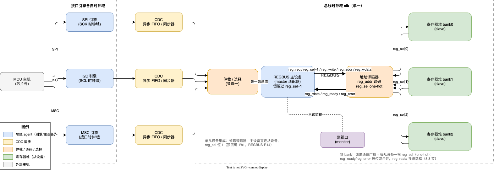
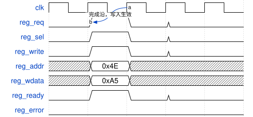
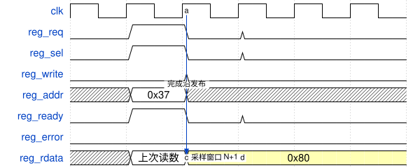
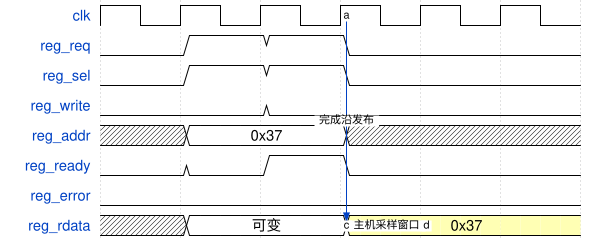
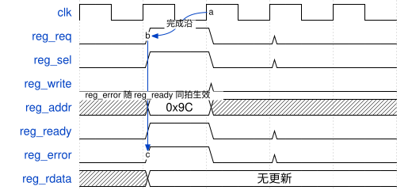
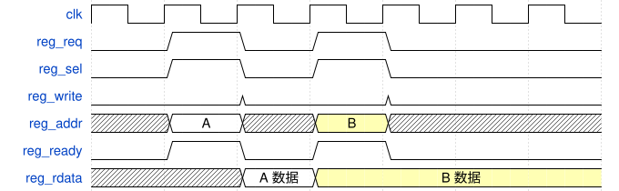
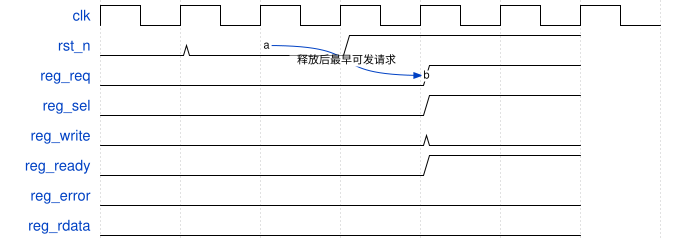

# REGBUS 8 位寄存器总线规范

| 项目 | 内容 |
|---|---|
| 文档编号 | REGBUS-SPEC-001 |
| 版本 | 1.3 |
| 日期 | 2026-10-25 |
| 作者 | dfxiao |
| 状态 | **Released** |

## 修订历史

| 版本 | 日期 | 作者 | 说明 |
|---|---|---|---|
| 1.0 | 2026-10-25 | dfxiao | 首次发布。定义 REGBUS 信号接口、请求/响应协议、<br />时序契约、地址空间规则、主从设备设计义务与验证合规项。 |
| 1.1 | 2026-10-25 | dfxiao | 明确错误访问的功能副作用边界及完成沿诊断记录；保留位按读写视图和从设备寄存器规格处理；同步从设备义务、示例及验证要求。 |
| 1.2 | 2026-10-25 | dfxiao | 全部接口信号、`reg_bus_pkg`/`reg_bus_if`及共享类型统一加`reg_`前缀，便于跨模块识别；协议规则、时序与方向语义不变。 |
| 1.3 | 2026-10-25 | dfxiao | 请求通道新增从设备选择线`reg_sel`：主设备恒驱动1，点对点集成等价于顶层绑1'b1；多从设备由地址译码器对`reg_addr`组合译码产生（one-hot）。新增REGBUS-R14、译码器义务（8.3节）与F系列合规项；R3/R6并入`reg_sel`。总体结构与图2-1改为译码器+多bank形态，6张时序图加绘`reg_sel`（按译码形态，随请求拉起/撤回）。绑1集成与v1.2完全兼容，握手时序不变。 |

---

## 目录

1. [引言](#sec-1)
2. [总体结构](#sec-2)
3. [信号接口](#sec-3)
4. [总线协议](#sec-4)
5. [时序图](#sec-5)
6. [时钟、复位与跨域约束](#sec-6)
7. [地址空间与译码](#sec-7)
8. [从设备设计指南](#sec-8)
9. [主设备设计指南](#sec-9)
10. [验证与合规](#sec-10)

- [附录 A　reg_bus_pkg 包源码](#sec-a)
- [附录 B　reg_bus_if 接口源码](#sec-b)
- [附录 C　集成示例](#sec-c)
- [附录 D　参考总线功能模型（BFM）](#sec-d)

---

<a id="sec-1"></a>

## 1 引言

REGBUS 是一条片内 8 位寄存器访问总线，用于把一个总线主设备（通常是串行
接口协议引擎）与一个寄存器堆从设备连起来。这份规范定义它的信号接口、
握手协议、请求与响应通道的时序契约、地址空间规则，以及主从设备各自要
满足的条件，使独立的 RTL 或验证工程师不依赖任何具体实现就能做出一个
REGBUS 主设备、从设备或监视 agent。写法上参照 AMBA AHB 规范的组织方式。基线形态是点对点单从设备；需要挂
多个寄存器堆时，经地址译码器扩展，从设备接口不变形（见[8.3 节](#sec-8-3)）。

规范正文按目标契约编写。"必须""不得"是规范性要求，"允许"表示可选行为。

不在本规范范围内的事：寄存器字段定义与访问属性（R/RW 等）由各集成方的
寄存器表定义；帧级或链路级的校验、重试策略在总线之外；寄存器堆内部的
保护机制（ECC、冗余校验、恢复写入等）同样在总线之外。

<a id="sec-1-1"></a>

### 1.1 术语

| 术语 | 含义 |
|---|---|
| REGBUS | 本规范定义的内部寄存器总线 |
| 主设备（master） | 发起请求的一方，驱动 `reg_req/reg_sel/reg_write/reg_addr/reg_wdata` |
| 从设备（slave） | 执行请求的一方，驱动 `reg_rdata/reg_ready/reg_error` |
| 监视口（monitor） | 只读观察全部总线信号的视角 |
| 事务 | 一次单拍读或写，从 `reg_req` 拉起到完成沿为止 |
| 选中请求 | 对某从设备，`reg_req=1 && reg_sel=1` 的请求周期（见[REGBUS-R14](#r14)） |
| 完成沿 | `reg_ready` 为高的最后一拍结束时那个 `clk` 上升沿 |
| 零等待 | 从设备在 `reg_req` 当拍就给出 `reg_ready`，无等待态 |
| 等待态 | `reg_req=1` 且 `reg_ready=0` 的总线周期 |
| CDC | 跨时钟域 |

---

<a id="sec-2"></a>

## 2 总体结构

REGBUS 是单主设备总线，另设只读监视口。从设备侧的基线形态是点对点：主
设备直连唯一从设备，恒驱动 `reg_sel=1`（等价于顶层绑 1'b1）。从设备侧
经地址译码器可扩展为多个寄存器堆 bank：译码器对 `reg_addr` 组合译码，
每从设备一根 one-hot `reg_sel`，从设备接口在两种形态下完全相同
（[REGBUS-R14](#r14)、[8.3 节](#sec-8-3)）。全部信号同步于同一个总线
时钟 `clk`，任何 REGBUS 信号都不跨时钟域。

典型集成里，总线前面可以挂多个协议接口引擎（SPI、I2C、MSC 等）。引擎
各自运行在自己的接口时钟域，请求经 CDC 同步进入总线时钟域，再经仲裁
汇成一条请求流，驱动唯一的主设备端口；主设备之后再经地址译码器把请求
分发到各 bank。整体结构见[图 2-1](#fig-2-1)。

<a id="fig-2-1"></a>



图 2-1　总体架构：多协议接口引擎经 CDC 汇聚到总线时钟域；主设备经地址译码器驱动多个从设备 bank（one-hot `reg_sel`；单从设备集成省略译码器、`reg_sel` 绑 1'b1）（图源`fig/src/architecture.drawio`，可用 draw.io 编辑）

<a id="sec-2-1"></a>

### 2.1 总线特性

| 属性 | 取值 |
|---|---|
| 拓扑 | 总线上单主设备、单从设备，点对点；接口侧可接多个协议引擎，经 CDC 与仲裁汇聚成唯一主设备端口；支持监视口；可经地址译码器扩展为多从设备，每从设备一根`reg_sel`（one-hot），见[8.3 节](#sec-8-3) |
| 时钟 | 单一 `clk` 域，频率由集成方定义 |
| 地址宽度 | 8 位（`REG_ADDR_WIDTH = 8`），字节寻址，无突发 |
| 数据宽度 | 8 位（`REG_DATA_WIDTH = 8`），仅单拍事务 |
| 在途事务数 | 1，前一事务完成后才能发下一个 |
| 等待态 | 支持任意拍数；从设备也可以实现为零等待 |
| 错误响应 | 支持，`reg_error` 由 `reg_ready` 限定 |
| 流水 | 请求与响应同拍重叠（零等待时）；读数据由从设备在完成沿寄存输出，下一拍有效（见[4.5 节](#sec-4-5)） |
| 总线级保护 | 无；链路级与寄存器级保护机制在总线之外实现 |
| 复位 | 异步低有效 `rst_n`，同步释放 |
| 接口形式 | SystemVerilog interface + modport，方向只由 modport 表达 |

几点设计上的考虑写在这里，方便后来的人理解为什么这样定：地址和数据固定
8 位，与常见串行配置帧、寄存器字节宽度一一对应，不引入宽度换算；单拍
事务、单在途，覆盖"一次命令帧最多一次寄存器访问"的典型场景；方向只由
modport 表达，接口实例可以原样传给主、从两个模块，不需要在顶层再拉一组
方向端口。请求通道带一根 `reg_sel` 从设备选择线：点对点集成主设备恒 1，
等价于这根线不存在；扩展多从设备时由地址译码器译码产生，从设备接口在
两种形态下完全一致（见[8.3 节](#sec-8-3)）。

<a id="sec-2-2"></a>

### 2.2 多协议主设备的接入

[图 2-1](#fig-2-1) 左侧的三个引擎只是示例，接口种类和数量都不限。接入要
遵守两条：

1. 每个引擎在自己的接口时钟域内完成协议解析（帧格式、校验都在域内
   做好），把解析完成的寄存器请求经 CDC 送进总线时钟域。CDC 结构按
   数据性质选：数据流用异步 FIFO，单发事件用翻转同步，电平用二级
   同步器。CDC 属于引擎侧功能——按 [REGBUS-R11](#r11)，跨域路径不得
   拉进总线。
2. 多个引擎汇入后必须仲裁，同一时刻只允许一条请求流驱动主设备端口，
   使总线上仍然只有一个主设备、一个在途事务（[REGBUS-R4](#r4)）。仲裁策略
   （固定优先级、轮询等）由集成方定；对总线而言，仲裁器加主设备适配器
   合起来就是那个唯一的 master。

主设备适配器把仲裁后的请求流变换成符合[第 4 章](#sec-4)的总线事务。有的
集成把仲裁和适配做在同一模块里，这只是实现划分，不影响规范。

监视口不参与协议。验证环境、覆盖率采集和总线一致性检查都从它取信号。

---

<a id="sec-3"></a>

## 3 信号接口

REGBUS 用一个 SystemVerilog interface 声明，带 `master`、`slave`、`monitor`
三个 modport。完整源码见[附录 A](#sec-a)、[附录 B](#sec-b)。

<a id="sec-3-1"></a>

### 3.1 请求通道（主设备 → 从设备）

| 信号 | 宽度 | 类型 | 稳定性要求 | 说明 |
|---|---|---|---|---|
| `reg_req` | 1 | `logic` | 拉起后保持到看见 `reg_ready` | 请求限定。`1` 表示当前周期呈现一次事务；完成后的下一拍必须撤掉。 |
| `reg_sel` | 1 | `logic` | `reg_req=1` 期间稳定 | 从设备选择。对从设备，`reg_req=1 && reg_sel=1` 才构成指向自己的请求。主设备恒驱动 1（[REGBUS-R14](#r14)）；多从设备集成由译码器对 `reg_addr` 组合译码改写为每从设备一根、one-hot（[8.3 节](#sec-8-3)）。相对 `reg_req` 的相位无约束，允许恒 1 或顶层绑 1'b1。 |
| `reg_write` | 1 | `logic` | `reg_req=1` 期间稳定 | 方向。`1` 写，`0` 读。 |
| `reg_addr` | 8 | `reg_addr_t` | `reg_req=1` 期间稳定 | 字节地址，完整 8 位 0x00–0xFF。 |
| `reg_wdata` | 8 | `reg_data_t` | `reg_req=1` 期间稳定 | 写数据字节。读事务中无意义，主设备仍应保持稳定。 |

<a id="sec-3-2"></a>

### 3.2 响应通道（从设备 → 主设备）

| 信号 | 宽度 | 类型 | 稳定性要求 | 说明 |
|---|---|---|---|---|
| `reg_ready` | 1 | `logic` | 允许对 `reg_req` 组合输出 | 完成限定。与 `reg_req=1` 同拍为高时，事务在本拍结束的上升沿完成。 |
| `reg_error` | 1 | `logic` | 最后一拍 `reg_ready` 周期内有效 | 错误指示，由 `reg_ready` 限定。`reg_ready=0` 期间不得被主设备采信。`1` 表示请求被拒绝（如地址未映射），主设备按 `reg_rdata=0x00` 处理。 |
| `reg_rdata` | 8 | `reg_data_t` | 寄存输出并保持（见[4.5 节](#sec-4-5)） | 读数据字节。从设备在完成沿发布，保持到下一次成功读完成为止。 |

<a id="sec-3-3"></a>

### 3.3 modport

| modport | `reg_req` | `reg_sel` | `reg_write` | `reg_addr` | `reg_wdata` | `reg_rdata` | `reg_ready` | `reg_error` |
|---|---|---|---|---|---|---|---|---|
| `master` | output | output | output | output | output | input | input | input |
| `slave` | input | input | input | input | input | output | output | output |
| `monitor` | input | input | input | input | input | input | input | input |

<a id="sec-3-4"></a>

### 3.4 共享负载类型

`reg_bus_pkg` 把两个通道打成 packed 结构体，供 FIFO、信箱和 checker 做
快照用，本身不承载协议含义：

```systemverilog
typedef struct packed {
    logic      reg_req  ;
    logic      reg_sel  ;
    logic      reg_write;
    reg_addr_t reg_addr ;
    reg_data_t reg_wdata;
} reg_bus_req_t;

typedef struct packed {
    reg_data_t reg_rdata;
    logic      reg_ready;
    logic      reg_error;
} reg_bus_rsp_t;

localparam reg_bus_req_t REG_BUS_REQ_IDLE = '{reg_req: 1'b0, reg_sel: 1'b0, reg_write: 1'b0, reg_addr: '0, reg_wdata: '0};
localparam reg_bus_rsp_t REG_BUS_RSP_IDLE = '{reg_rdata: '0, reg_ready: 1'b0, reg_error: 1'b0};
```

---

<a id="sec-4"></a>

## 4 总线协议

<a id="sec-4-1"></a>

### 4.1 事务的两个阶段

一次事务分请求阶段和响应阶段。零等待时两个阶段在同一拍重叠：主设备在
第 N 拍呈现 `reg_req/reg_sel/reg_write/reg_addr/reg_wdata`，从设备同拍给出 `reg_ready`（以及 `reg_error`），
事务在第 N 拍结束的上升沿（完成沿）完成。带等待态时，请求通道在等待期间
原样保持，`reg_ready` 晚若干拍出现，完成沿是 `reg_ready` 为高的最后一拍结束时
的那个上升沿。

<a id="sec-4-2"></a>

### 4.2 协议规则

通用：

- <a id="r1"></a>**REGBUS-R1**　所有 agent 同步于 `clk`。任何 REGBUS 信号不得由其他时钟域直接驱动或采样。
- <a id="r2"></a>**REGBUS-R2**　`rst_n` 有效期间及释放后：主设备不得发请求；从设备 `reg_ready=0`、`reg_error=0`、`reg_rdata=0x00`。复位释放后的第一个 `clk` 上升沿之前不得出现 `reg_req=1`。

请求通道（主设备义务）：

- <a id="r3"></a>**REGBUS-R3**　`reg_req` 拉起后，`reg_req/reg_sel/reg_write/reg_addr/reg_wdata` 每一拍都必须保持不变，直到观察到某一拍 `reg_ready=1`。事务中途不得改写、不得撤回。
- <a id="r4"></a>**REGBUS-R4**　在途事务最多一个。下一个 `reg_req` 最早在完成沿的下一拍才能拉起。
- <a id="r5"></a>**REGBUS-R5**　完成沿的下一拍，主设备必须撤掉 `reg_req`。
- <a id="r14"></a>**REGBUS-R14**　`reg_sel` 是请求通道的从设备选择限定：主设备恒驱动 1，不做地址译码，保持地址无关；经地址译码器扩展为多从设备时，译码器对 `reg_addr` 组合译码，为每根下游接口实例产生一根 `reg_sel`，任意时刻至多一根为 1（one-hot，译码器义务见[8.3 节](#sec-8-3)）。对从设备，`reg_req=1 && reg_sel=1` 才构成指向自己的请求；`reg_sel` 相对 `reg_req` 的相位无约束，点对点集成允许恒 1 或顶层绑 1'b1。

响应通道（从设备义务）：

- <a id="r6"></a>**REGBUS-R6**　`reg_ready` 可以对 `reg_req && reg_sel` 组合输出（零等待），也可以在任意拍数的等待态之后给出。`reg_req=0` 或 `reg_sel=0` 时不得给出 `reg_ready=1`。
- <a id="r7"></a>**REGBUS-R7**　`reg_error` 只在 `reg_req=1 && reg_ready=1` 的拍上有意义；`reg_ready=0` 期间从设备应保持 `reg_error=0`。主设备只在完成沿采样 `reg_error`。
- <a id="r8"></a>**REGBUS-R8**　`reg_error=1` 表示本次访问被拒绝：不得提交目标配置或数据写入，不得触发功能动作、消费操作结果，或执行读清等访问副作用。允许从设备仅按其寄存器规格记录明确列出的访问错误诊断；诊断只在错误事务完成沿记录一次。错误响应不更新 `reg_rdata`，主设备按 `0x00` 处理。独立于本次访问发生的硬件状态更新不受此条冻结。

读数据：

- <a id="r9"></a>**REGBUS-R9**　见[4.5 节](#sec-4-5)。从设备在成功读完成沿把 `reg_rdata` 寄存输出，保持到下一次成功读完成。主设备在完成沿的下一拍采样 `reg_rdata`。

<a id="sec-4-3"></a>

### 4.3 请求译码

从设备在 `reg_req=1` 的每一拍采样请求通道，典型译码：

```systemverilog
wire wr_en     = bus.reg_req && bus.reg_sel &&  bus.reg_write;
wire rd_en     = bus.reg_req && bus.reg_sel && !bus.reg_write;
wire wr_commit = wr_en && bus.reg_ready && !bus.reg_error;
wire rd_commit = rd_en && bus.reg_ready && !bus.reg_error;
```

wr_en/rd_en只表示请求方向，不是提交事件。写入及功能动作仅由wr_commit在完成沿提交，成功读由rd_commit在完成沿发布。从设备可以在完成前插入任意拍等待态。错误诊断使用reg_req && reg_sel && reg_ready && reg_error的完成事件，不得使用reg_req或reg_error的持续电平重复记录。

<a id="sec-4-4"></a>

### 4.4 错误响应

推荐的做法是对未映射地址（见[7.1 节](#sec-7-1)）组合给出错误：

```systemverilog
assign bus.reg_ready = bus.reg_req && bus.reg_sel;
assign bus.reg_error = bus.reg_req && bus.reg_sel && !hit;
```

错误事务与正常事务一样在 `reg_req=1 && reg_ready=1` 的完成沿结束。`reg_rdata` 不更新，主设备根据该沿采样的 `reg_error` 按 `0x00` 处理。被拒绝的功能写入必须整笔无效，不得部分更新有效字段；被拒绝的读不得触发读清或其他功能副作用。

从设备允许实现错误码、粘滞位、计数器、诊断事件或中断，但必须在其寄存器/接口规格中明确诊断对象、更新条件、覆盖/累计规则及清除来源；也允许不实现诊断。每笔错误事务仅在完成沿记录一次，等待期间不得重复计数或重新覆盖错误历史。诊断不得消费功能结果、启动操作或充当未定义的功能写入口。

“错误访问无功能副作用”不要求整个寄存器堆在该周期冻结。独立运行的状态机、采样逻辑及既有会话可按自身规则更新；验证应区分被拒绝访问导致的变化、已声明的诊断变化和独立硬件变化。诊断清除与新错误同沿的优先级由从设备规格明确规定。

<a id="sec-4-5"></a>

### 4.5 读数据时序

规范要求的读路径只在成功读的完成沿寄存输出（rd_commit定义见[4.3节](#sec-4-3)）：

```systemverilog
always_ff @(posedge clk or negedge rst_n) begin
    if (!rst_n)      bus.reg_rdata <= '0;
    else if (rd_commit) bus.reg_rdata <= <bus.reg_addr 选中寄存器的当前值>;
end
```

由此得到三条时序事实（[图 4-2](#fig-4-2)）：`reg_rdata` 在完成沿的下一拍
（第 N+1 拍）变为本次读数；此后一直保持，直到下一次成功读的完成沿，写事务和
空闲周期都不影响它；主设备在第 N+1 拍采样。[附录 D](#sec-d) 的参考 BFM
就是按这个时序写的。

如果某个从设备改为在最后一拍 `reg_ready` 周期内组合输出 `reg_rdata`，那么它必须
把该值继续稳定保持到 N+1 拍结束，才能与遵循 [REGBUS-R9](#r9) 的主设备
兼容。

<a id="sec-4-6"></a>

### 4.6 等待态

从设备可以将 `reg_ready` 压低任意拍。等待期间：请求通道不得变化
（[REGBUS-R3](#r3)）；`reg_error` 不得被采信（[REGBUS-R7](#r7)），允许提前
预览，但主设备只在完成沿采样；读事务的 `reg_rdata` 可以任意变化，只有
[4.5 节](#sec-4-5)采样窗口内的值有架构意义。主设备必须在任意拍数的
等待态下保持请求不变。

<a id="sec-4-7"></a>

### 4.7 背靠背事务

按 [REGBUS-R4](#r4)/[REGBUS-R5](#r5)，两个事务之间至少隔一拍，见
[图 5-3](#fig-5-3)。这条规则是给将来可能新增的主设备准备的；典型集成里
主设备在两次事务之间本来就有空闲拍。

<a id="sec-4-8"></a>

### 4.8 复位行为

`rst_n` 异步拉低、同步释放。复位期间与释放后各信号的状态：

| 信号 | `rst_n=0` 期间 | 首次有效时机 |
|---|---|---|
| `reg_req/reg_sel/reg_write/reg_addr/reg_wdata` | 0（主设备寄存器复位；`reg_sel` 恒 1 驱动或绑 1'b1 者除外） | 释放后任意拍 |
| `reg_ready` | 0 | 释放后跟随 `reg_req` 组合出现 |
| `reg_error` | 0 | 随第一次 `reg_ready` |
| `reg_rdata` | 0x00（复位值） | 第一次读的完成沿发布新值 |

复位打断在途事务时，事务作废。寄存器堆应按整字节在单拍内写完，使一次写
要么整体生效、要么整体没发生，不存在半字节状态。

---

<a id="sec-5"></a>

## 5 时序图

以下时序图由 `fig/src/*.json`（WaveDrom 源文件）渲染生成；修改时序图请改
JSON 源后重新渲染，不要直接改 SVG。周期均为 `clk` 周期，图中的地址、
数据为示例值。`reg_sel` 是请求通道的又一个限定符，图中按译码器产生的
形态绘制：随选中请求拉起、空闲撤回，`reg_req=1` 期间与请求通道一起保持
（[REGBUS-R3](#r3)/[REGBUS-R14](#r14)）；主设备恒 1/绑 1 集成下它是
常数 1，两种相位均合规。

<a id="sec-5-1"></a>

### 5.1 零等待写

<a id="fig-4-1"></a>



图 4-1　零等待写：`reg_ready=reg_req && reg_sel` 组合输出，写数据在完成沿写入从设备

<a id="sec-5-2"></a>

### 5.2 零等待读与 reg_rdata 相位

<a id="fig-4-2"></a>



图 4-2　零等待读：完成沿发布新数据，主设备在 N+1 拍采样（[REGBUS-R9](#r9)）

<a id="sec-5-3"></a>

### 5.3 带一拍等待态的读

<a id="fig-5-1"></a>



图 5-1　带一拍等待态的读：请求通道保持不变，`reg_rdata` 在等待期间可变，完成沿发布后进入采样窗口

<a id="sec-5-4"></a>

### 5.4 错误响应

<a id="fig-5-2"></a>



图 5-2　错误响应：`reg_error` 与 `reg_ready` 同拍生效，事务照常完成，`reg_rdata` 不更新，主设备按 `0x00` 处理

<a id="sec-5-5"></a>

### 5.5 背靠背最小间距

<a id="fig-5-3"></a>



图 5-3　背靠背最小间距：完成沿后至少空一拍才能发起下一个事务

<a id="sec-5-6"></a>

### 5.6 复位

<a id="fig-5-4"></a>



图 5-4　复位：释放后请求才允许出现，`reg_rdata` 保持 0x00 直到第一次读

---

<a id="sec-6"></a>

## 6 时钟、复位与跨域约束

- <a id="r10"></a>**REGBUS-R10**　总线只跑在单一 `clk` 上，频率由集成方定义。每个 REGBUS 信号要么是 `clk` 的寄存输出，要么是这类信号与同域输入的组合函数。
- <a id="r11"></a>**REGBUS-R11**　任何 REGBUS 信号不得跨时钟域采样或驱动。如果总线某一侧需要与另一个时钟域交互（协议引擎、模拟接口等），跨域必须在该侧 agent 内部用 FIFO、握手或同步器完成（见[2.2 节](#sec-2-2)），不得把跨域路径拉进总线。
- <a id="r12"></a>**REGBUS-R12**　复位使用异步低有效 `rst_n`，各 agent 按[4.8 节](#sec-4-8)恢复。
- <a id="r13"></a>**REGBUS-R13**　总线不得门控时钟。寄存器访问通常是诊断与调试通路，在低功耗和故障状态下也必须可用；位于总线之后的局部门控不受本条约束。

时序收敛上提醒一句：零等待从设备的 `reg_req → reg_ready/reg_error` 是组合路径，
`reg_addr → reg_rdata` 是一拍寄存。集成时注意这两条的逻辑深度，主设备完成沿采样
的触发器要放在 `clk` 域，接口与主设备触发器之间不要再插逻辑。

---

<a id="sec-7"></a>

## 7 地址空间与译码

<a id="sec-7-1"></a>

### 7.1 地址空间

地址空间为完整 8 位 0x00–0xFF，字节寻址。规范本身不规定哪些地址映射哪些
寄存器——映射表由集成方的寄存器规格定义——但规定以下规则：

- 从设备必须实现确定的地址命中函数（组合、仅依赖 `reg_addr`），命中集合外的一切地址返回 `reg_error=1`，`reg_rdata` 不更新（[REGBUS-R8](#r8)）；
- 地址命中分两层：多从设备集成时，bank 级命中由地址译码器完成（产生 `reg_sel`，未命中由译码器合成错误完成响应，见[8.3 节](#sec-8-3)）；从设备的 hit 函数只负责本 bank 内的寄存器级命中。两层未命中都以 `reg_error=1` 完成事务、不产生功能副作用。
- 寄存器必须按读、写方向分别定义字段。读视图中的保留位读0；同一地址的写视图可以定义不同用途，不能把写保留位的位置直接认定为读保留位。
- 写视图中保留位的处理由从设备寄存器规格明确规定，不由REGBUS统一固定。允许写忽略，也允许非法值导致整笔拒绝；不得使用未声明的默认策略。
- 采用写忽略时，只忽略已声明的保留位，不改变其余有效字段的写入规则。采用严格保护时，非法写返回reg_error=1，整笔功能写入不提交，包括该笔中原本合法的字段；允许的诊断记录仍按[REGBUS-R8](#r8)处理。
- 独立RO地址的写入策略同样由寄存器规格定义。其拒绝不能因所写数据为0或保留位为0而被自动放行。
- 地址在到达总线之前必须已经是完整的 8 位。地址高位如何产生（分页寄存器、帧内直接位、安全锁等）属于总线之前的功能，总线与从设备不感知。

<a id="sec-7-2"></a>

### 7.2 译码侧带

从设备可以从请求通道派生单拍选通（读选通、写选通、特定地址事件等），
它们是功能译码事件而非总线信号，必须由成功完成沿提交：功能侧带事件只能由 `reg_req && reg_sel && reg_ready && !reg_error` 产生，出错事务不得触发功能动作。若从设备声明了访问错误诊断，其记录或诊断事件由 `reg_req && reg_sel && reg_ready && reg_error` 产生，按[4.4节](#sec-4-4)处理，不属于功能侧带动作。

---

<a id="sec-8"></a>

## 8 从设备设计指南

<a id="sec-8-1"></a>

### 8.1 义务

一个合规的 REGBUS 从设备必须做到：

1. 每拍采样 `reg_req/reg_sel/reg_write/reg_addr/reg_wdata`，只在 `reg_req=1 && reg_sel=1` 的拍动作，写只在完成沿提交；
2. 按 [REGBUS-R6](#r6) 产生 `reg_ready`（对 `reg_req && reg_sel` 组合的零等待方式允许；`reg_sel=0` 时必须静默）；
3. 按 [REGBUS-R7](#r7)/[REGBUS-R8](#r8) 对无法执行的请求给出 `reg_error`，不得产生功能副作用；仅允许从设备规格已声明的完成沿诊断记录；
4. 按 [REGBUS-R9](#r9) 发布读数据：成功读的完成沿寄存输出 `reg_rdata`，保持到下一次成功读完成；
5. 复位行为符合[4.8 节](#sec-4-8)；
6. 写整字节在完成拍原子完成，不得出现总线可见的多拍写序列。

<a id="sec-8-2"></a>

### 8.2 实现要点

地址命中与 `reg_ready/reg_error` 用组合逻辑给出即可满足零等待（表达式并入
`reg_sel` 门控，示例见[4.4 节](#sec-4-4)）；读路径一拍寄存
天然满足 [REGBUS-R9](#r9) 的发布与保持语义，不需要额外的保持逻辑。需要
多拍才能给出读数据的寄存器（例如要先冻结测量值），用等待态把 `reg_ready`
压低，在最后一个等待拍把数据准备好，再在完成沿按统一语义发布。

如果从设备内部还有第二个写入口（配置恢复、测试注入之类），它必须与总线
写走同一套译码与写仲裁；当且仅当能证明总线主设备在该入口活动期间必然
空闲时，才允许省略仲裁。

<a id="sec-8-3"></a>

### 8.3 多从设备扩展（地址译码）

基线拓扑是点对点的：主设备恒驱动 `reg_sel=1`（[REGBUS-R14](#r14)），这根
线就是那个从设备的选择，无需任何额外逻辑。要挂第二个从设备时，在主设备
端口与各从设备之间插一个地址译码器（fabric），由它代替主设备成为每个下游
接口实例的请求通道驱动方。译码器必须做到：

1. `reg_req/reg_write/reg_addr/reg_wdata` 原样转发给全部下游从设备；每从设备一根 `reg_sel`，由 `reg_addr` 组合译码产生，任意时刻至多一根为 1（one-hot），`reg_req=1` 期间保持不变（[REGBUS-R3](#r3)/[REGBUS-R14](#r14)）；
2. bank 级未命中——地址不属于任何从设备的命中集合——译码器必须自行合成完成响应：`reg_ready=1 && reg_error=1`，`reg_rdata` 保持不变，不得产生功能副作用（与 [REGBUS-R8](#r8) 同语义）；
3. `reg_ready/reg_error` 按位或合并：未被选中的从设备按 [REGBUS-R6](#r6) 必须静默（`reg_sel=0` 时 `reg_ready=0`、`reg_error=0`）；
4. `reg_rdata` 做多路选择：选择信号取当前 `reg_sel`，并在每次成功读完成沿随数据发布一起寄存，至少保持到主设备采样拍（N+1，见[4.5 节](#sec-4-5)）结束，使 [REGBUS-R9](#r9) 的发布-保持语义在合并点之后依然成立；
5. 从设备接口与点对点形态完全相同——它不感知译码器和兄弟从设备的存在，本 bank 内的寄存器级命中/未命中仍按[7.1 节](#sec-7-1)由自己的 hit 函数处理。

分拆后总线上仍然是单主设备、单在途事务（[REGBUS-R4](#r4)）；接口侧多协议
汇聚（[2.2 节](#sec-2-2)）与此扩展正交，可叠加。

---

<a id="sec-9"></a>

## 9 主设备设计指南

<a id="sec-9-1"></a>

### 9.1 义务

一个合规的 REGBUS 主设备必须做到：

1. 只有在一次事务的 `reg_write/reg_addr/reg_wdata` 全部有效且能保持时才拉起 `reg_req`，之后保持到完成（[REGBUS-R3](#r3)）；
2. 在途事务最多一个（[REGBUS-R4](#r4)），完成沿的下一拍撤掉 `reg_req`（[REGBUS-R5](#r5)）；
3. 只在完成沿采样 `reg_error`；`reg_error=1` 时把 `reg_rdata` 当 `0x00`，并执行集成方定义的错误策略；
4. 在完成沿的下一拍采样 `reg_rdata`（[REGBUS-R9](#r9)）；
5. 复位期间不发请求（[REGBUS-R2](#r2)）；
6. 恒驱动 `reg_sel=1`（[REGBUS-R14](#r14)），不做地址译码；多从设备分拆由译码器完成，主设备保持地址无关。

<a id="sec-9-2"></a>

### 9.2 典型状态机

一个满足全部规则的主设备可以按下面的状态机组织：

```
 IDLE ──请求有效──▶ ISSUE ──载荷锁存──▶ ACCESS ──reg_ready──▶ SAMPLE ──▶ IDLE
 (空闲)            (准备)             (reg_req=1,等待完成)   (次拍采样 reg_rdata)
```

要点：`reg_req` 做成 `ACCESS` 态的纯组合函数，载荷（`reg_write/reg_addr/reg_wdata`）在
`ISSUE` 态锁存、进入 `ACCESS` 后冻结，[REGBUS-R3](#r3)/[REGBUS-R5](#r5)
就自然满足；`reg_error` 在 `ACCESS` 的完成沿采样，`reg_rdata` 在 `SAMPLE`
（完成沿的下一拍）采样。完成之后至少回到 `IDLE` 一拍，再考虑下一次请求。

---

<a id="sec-10"></a>

## 10 验证与合规

<a id="sec-10-1"></a>

### 10.1 合规检查表

主设备：

| 编号 | 检查项 | 规则 |
|---|---|---|
| M-1 | `reg_req=1` 期间请求通道稳定直到 `reg_ready` | [R3](#r3) |
| M-2 | 单在途事务；完成后 `reg_req` 撤掉 | [R4](#r4)/[R5](#r5) |
| M-3 | `reg_error` 只在完成沿采样 | [R7](#r7) |
| M-4 | `reg_rdata` 在完成沿下一拍采样 | [R9](#r9) |
| M-5 | 复位期间无请求，释放后状态干净 | [R2](#r2) |
| M-6 | `reg_sel` 恒 1；译码集成时由译码器接管且 one-hot | [R14](#r14) |

从设备：

| 编号 | 检查项 | 规则 |
|---|---|---|
| S-1 | `reg_req=0` 或 `reg_sel=0` 时不得有 `reg_ready=1` | [R6](#r6)/[R14](#r14) |
| S-2 | `reg_error` 只随 `reg_ready` 有意义；错误不提交功能写入/动作，仅按声明记录一次诊断；独立硬件变化不冻结 | [R7](#r7)/[R8](#r8) |
| S-3 | `reg_rdata` 完成沿发布、保持到下次成功读 | [R9](#r9) |
| S-4 | 整字节写在完成拍原子完成 | [8.1](#sec-8-1) |
| S-5 | 未映射地址回 `reg_error`；保留位按读写视图及从设备声明处理，非法严格写整笔拒绝 | [7.1](#sec-7-1) |
| S-6 | 复位值符合[4.8 节](#sec-4-8) | [R2](#r2) |

译码器（多从设备集成时）：

| 编号 | 检查项 | 规则 |
|---|---|---|
| F-1 | `reg_sel` one-hot，任意时刻至多一根；`reg_req=1` 期间稳定 | [R14](#r14)/[R3](#r3) |
| F-2 | bank 级未命中地址由译码器合成 `reg_ready=1 && reg_error=1` 完成响应，无功能副作用 | [8.3](#sec-8-3)/[R8](#r8) |
| F-3 | `reg_rdata` 多路选择在主设备采样拍（N+1）保持正确 | [8.3](#sec-8-3)/[R9](#r9) |

<a id="sec-10-2"></a>

### 10.2 建议的最小验证场景

不论用什么仿真环境，一个 REGBUS agent 的回归至少应覆盖：

1. 零等待读、零等待写，数据经总线往返一致；
2. 带等待态的读与写（含最长等待），请求通道在等待期间逐拍稳定；
3. 未映射地址的错误响应，目标功能配置/数据无访问引起的变化；诊断按从设备声明更新，独立硬件状态按模型处理；
4. 序列中间插错误后紧跟正常事务；
5. 同一地址写后读；
6. `reg_rdata` 保持语义：两次读不同地址，确认每次返回的是各自地址的数据；
7. 背靠背最小间距；
8. 等待态中间复位、复位后首次访问；
9. 对声明了诊断的从设备，插入多拍等待后错误完成，仅记录一次；检查错误覆盖/累计、清除及同沿优先级；
10. 按从设备声明验证写忽略或严格保留位策略；严格拒绝时，即使同笔含合法字段也不得部分提交；
11. 检查读/写视图不同的地址，写保留位置的读状态不得被误判为固定0；被拒绝读不得执行读清或消费结果；
12. 多从设备集成时：`reg_sel` one-hot 且事务期间稳定、跨 bank 访问互不串扰、未命中 bank 的地址返回错误且无功能副作用、两次读不同 bank 地址返回各自数据。

---

<a id="sec-a"></a>

## 附录 A　`reg_bus_pkg` 包源码

```systemverilog
package reg_bus_pkg;
    parameter int unsigned REG_ADDR_WIDTH = 8;
    parameter int unsigned REG_DATA_WIDTH = 8;

    typedef logic [REG_ADDR_WIDTH-1:0] reg_addr_t;
    typedef logic [REG_DATA_WIDTH-1:0] reg_data_t;

    typedef struct packed {
        logic      reg_req  ;
        logic      reg_sel  ;
        logic      reg_write;
        reg_addr_t reg_addr ;
        reg_data_t reg_wdata;
    } reg_bus_req_t;

    typedef struct packed {
        reg_data_t reg_rdata;
        logic      reg_ready;
        logic      reg_error;
    } reg_bus_rsp_t;

    localparam reg_bus_req_t REG_BUS_REQ_IDLE = '{reg_req: 1'b0, reg_sel: 1'b0, reg_write: 1'b0, reg_addr: '0, reg_wdata: '0};
    localparam reg_bus_rsp_t REG_BUS_RSP_IDLE = '{reg_rdata: '0, reg_ready: 1'b0, reg_error: 1'b0};
endpackage
```

<a id="sec-b"></a>

## 附录 B　`reg_bus_if` 接口源码

```systemverilog
interface reg_bus_if;
    import reg_bus_pkg::*;

    logic      reg_req  ;
    logic      reg_sel  ;
    logic      reg_write;
    reg_addr_t reg_addr ;
    reg_data_t reg_wdata;
    reg_data_t reg_rdata;
    logic      reg_ready;
    logic      reg_error;

    modport master(output reg_req, output reg_sel, output reg_write, output reg_addr, output reg_wdata, input reg_rdata, input reg_ready, input reg_error);
    modport slave (input reg_req, input reg_sel, input reg_write, input reg_addr, input reg_wdata, output reg_rdata, output reg_ready, output reg_error);
    modport monitor(input reg_req, input reg_sel, input reg_write, input reg_addr, input reg_wdata, input reg_rdata, input reg_ready, input reg_error);
endinterface
```

<a id="sec-c"></a>

## 附录 C　集成示例

集成顶层持有接口实例，按 modport 传给主、从两个模块，不为总线信号另拉
方向端口：

```systemverilog
module chip_top (...);
    reg_bus_if bus ();                            // 实例化总线

    bus_master u_master (                         // 仲裁 + 主设备适配器
        // ...
        .bus ( bus ),                             // .master 视角
        // ...
    );

    bus_slave u_slave (
        // ...
        .bus ( bus ),                             // .slave 视角
        // ...
    );

    // 点对点：u_master 恒驱动 reg_sel=1（REGBUS-R14），等价于顶层绑 1'b1；
    // 多从设备时在主、从之间插地址译码器改写 reg_sel，从设备接口不变（8.3 节）

    // 只读观测抽头（不参与协议）：
    assign reg_req_o   = bus.reg_req  ;
    assign reg_sel_o   = bus.reg_sel  ;
    assign reg_write_o = bus.reg_write;
    assign reg_addr_o  = bus.reg_addr ;
    assign reg_wdata_o = bus.reg_wdata;
    assign reg_ready_o = bus.reg_ready;
    assign reg_error_o = bus.reg_error;
endmodule
```

仿真期观测用 `reg_bus_if.monitor` bind 到监视模块即可。

<a id="sec-d"></a>

## 附录 D　参考总线功能模型（BFM）

一个满足全部主设备规则的请求-完成-采样序列。注意采样点在完成沿之后、
即 `reg_ready` 的下一拍，这是 [REGBUS-R9](#r9) 的主设备行为：

```python
async def bus_access(dut, write_enable, address, data=0):
    dut.reg_req_i.value   = 1
    dut.reg_sel_i.value   = 1                # 主设备恒 1（REGBUS-R14）
    dut.reg_write_i.value = write_enable
    dut.reg_addr_i.value  = address
    dut.reg_wdata_i.value = data
    await RisingEdge(dut.clk)             # 完成沿（零等待从设备）
    await Timer(2, unit="ns")             # 进入 N+1 拍，reg_rdata 已发布
    reg_result = int(dut.reg_rdata_o.value)       # REGBUS-R9 采样窗口
    reg_ready  = int(dut.reg_ready_o.value)
    reg_error  = int(dut.reg_error_o.value)
    dut.reg_req_i.value = 0                   # 完成后撤请求（R5）
    await RisingEdge(dut.clk)
    assert reg_ready == 1
    return reg_result, reg_error
```

---

*规范结束　REGBUS-SPEC-001 v1.3*
